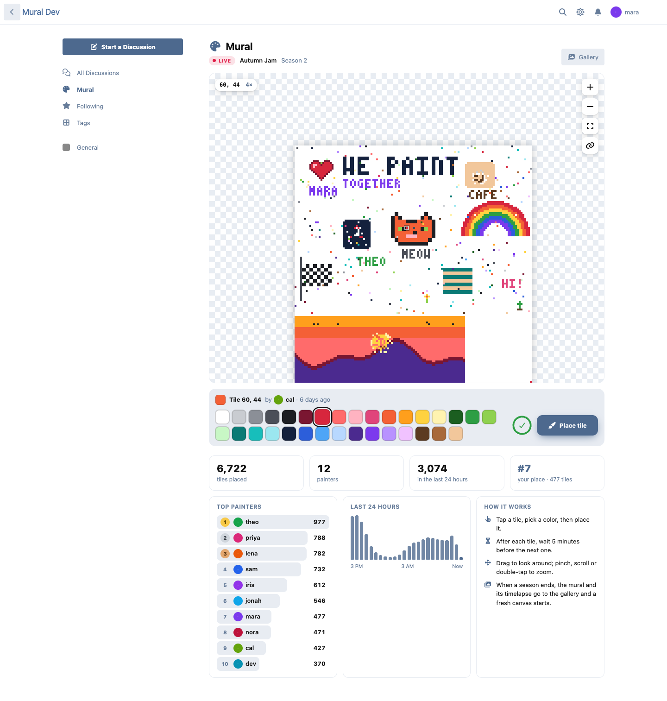
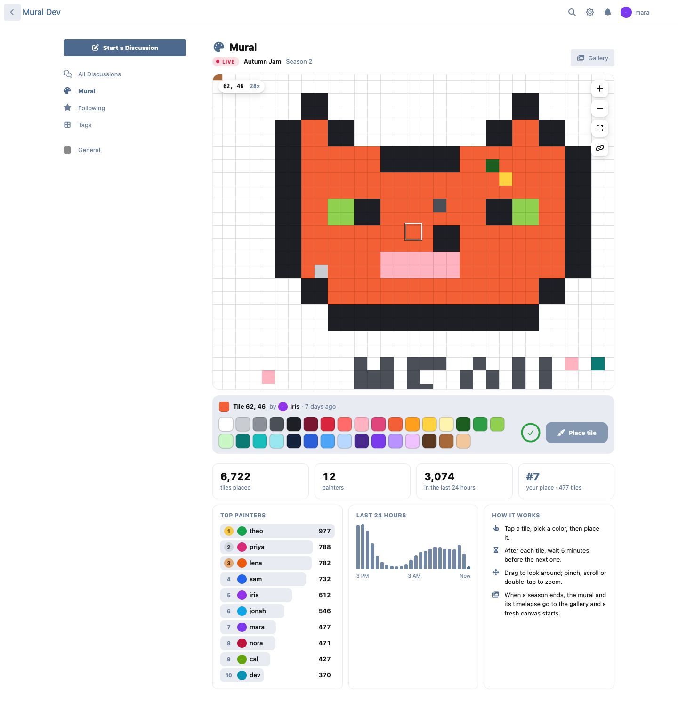
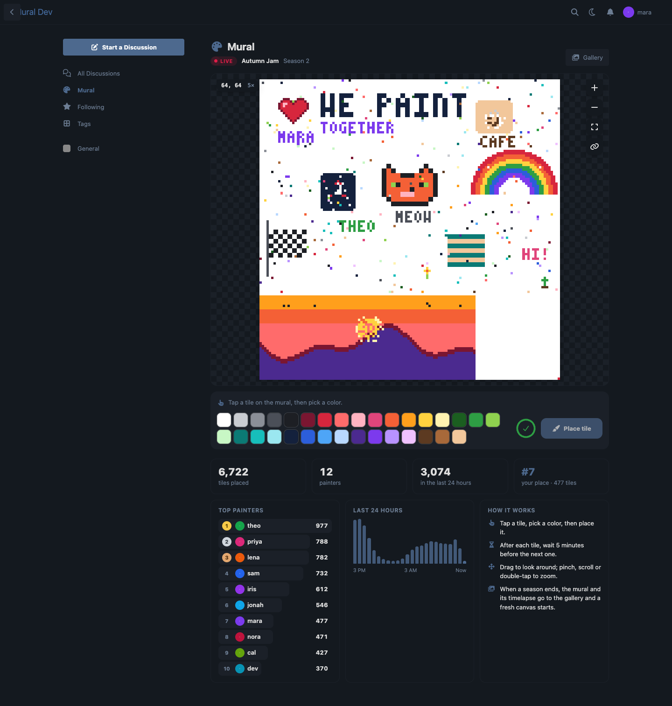
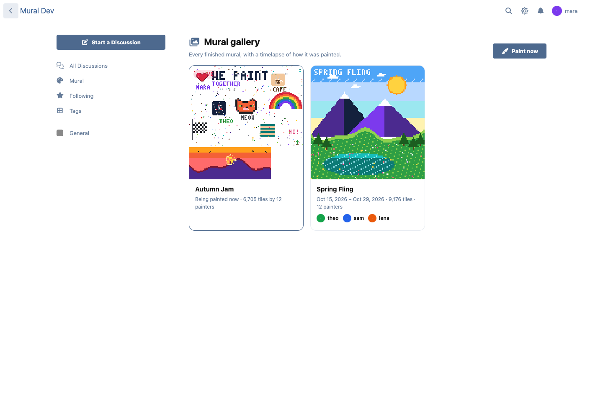
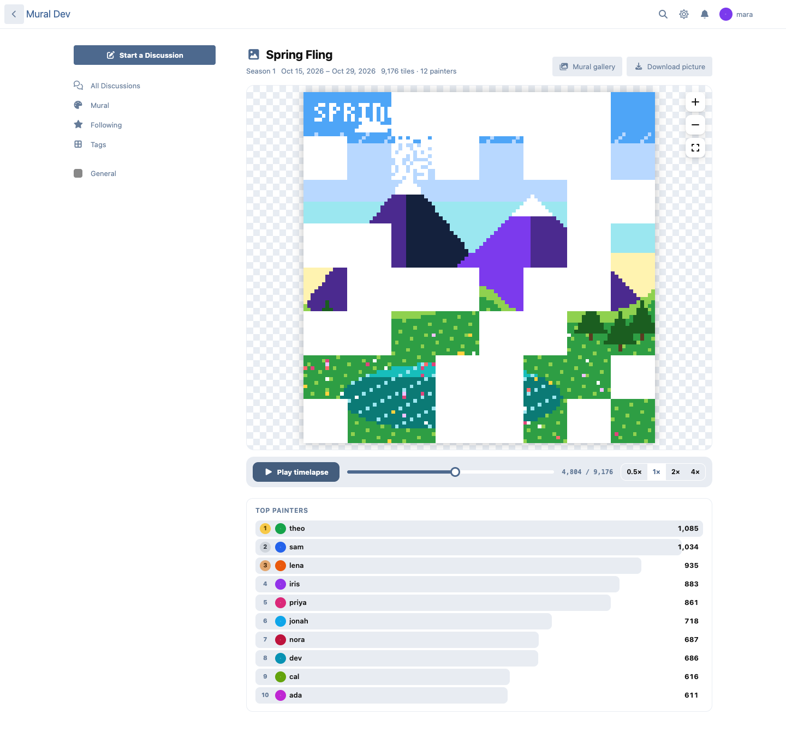
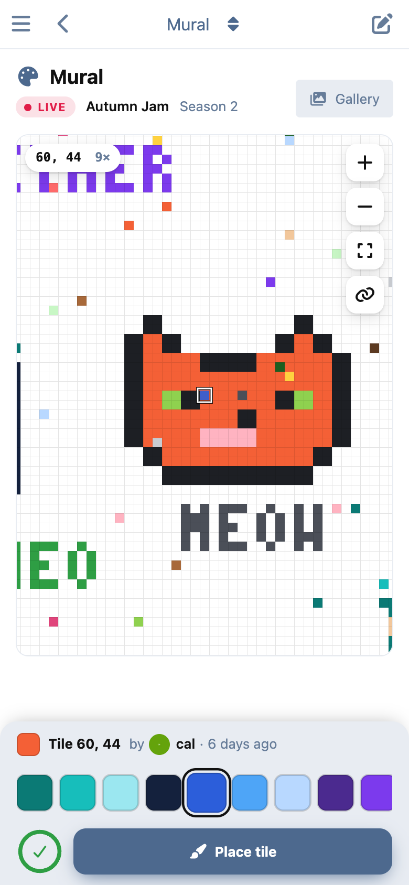
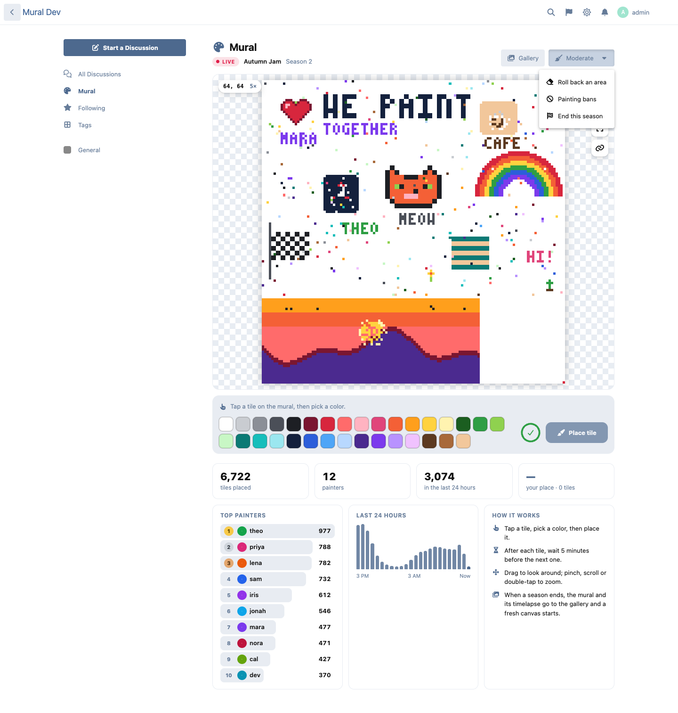

# Mural

One shared canvas your whole Flarum 2 community paints together, one tile at a time.

 [](https://packagist.org/packages/ernestdefoe/mural)



- **One canvas, everyone.** A grid of tiles (you choose the size, 16 to 512 a side) and a palette of up to 32 colors. Tap a tile, pick a color, place it.
- **A cooldown that holds.** Each member places one tile, then waits (five minutes by default). The wait is decided on the server, so a second tab, a double tap or a script gets nothing extra. Groups can wait less: give supporters or staff a shorter cooldown.
- **Smooth on every screen.** Drag to look around, with a little momentum. Pinch, scroll or double-tap to zoom, right down to single tiles with a grid. It's one `<canvas>`, so it stays fast at full zoom on a phone. On phones the colors and the Place button stay at the bottom of the screen.
- **Who painted this?** Rest the pointer on a tile, or tap it, to see who placed it and when.
- **Live.** With flarum/realtime, new tiles appear the moment they're placed, with a little ring. Without it, open canvases check for changes every few seconds, and a quiet canvas answers from the cache without touching the database.
- **Seasons and a gallery.** A moderator ends a season when it's done: its picture is saved, along with a timelapse of every tile in the order it was placed, and a fresh canvas starts. The gallery shows every finished mural; each one plays back with a scrubber and four speeds, and the picture can be downloaded.
- **Stats.** Tiles placed, painters, painting now, the last 24 hours hour by hour, the top painters and your own place.
- **A live picture in the sidebar.** A small, always-current picture of the canvas, a click away from painting. Also a widget for Bespoke and FoF Forum Widgets.
- **Share a spot.** The address follows where you're looking, so a link opens on the same tiles.
- **Moderation.** Roll back an area: drag over it, pick whose tiles and/or a time range, see exactly how many tiles that undoes, and do it. Nothing is deleted, so a rollback can be undone. Ban a member from painting for some days or until lifted.
- **Cadence.** With ernestdefoe/cadence installed, a tile counts as the day's activity and keeps a member's streak alive.
- **Permissions** to view, paint and moderate. **GDPR**: with Flarum's GDPR extension, a member's tiles are in their data export, and erasing them keeps the art but forgets who painted it.

## Screenshots

| | |
|---|---|
|  |  |
|  |  |
|  |  |

## Install

```sh
composer require ernestdefoe/mural
```

## Update

```sh
composer update ernestdefoe/mural
php flarum migrate
php flarum cache:clear
```

## Links

- [Packagist](https://packagist.org/packages/ernestdefoe/mural)
- [GitHub](https://github.com/ernestdefoe/mural)
